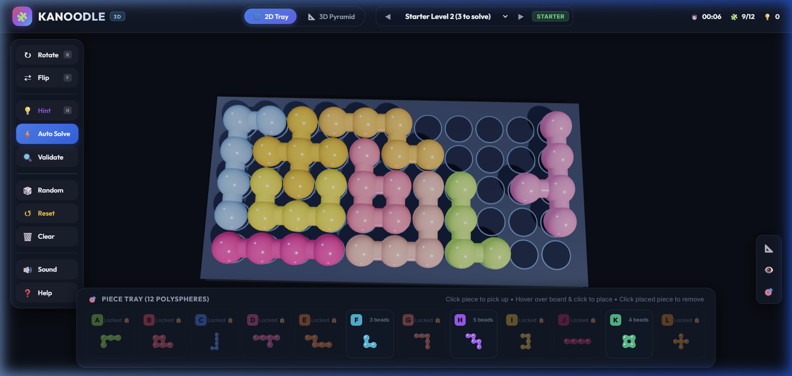

# Kanoodle 3D 🧩

A premium, tactile, colorful 3D web puzzle game inspired by the classic **Kanoodle** brain teaser by Educational Insights.

[](https://diptarkasamanta.github.io/Kanoodle/)



## 🌐 Play Online in Your Browser

You can play Kanoodle 3D directly in your browser without installing anything:
👉 **[https://diptarkasamanta.github.io/Kanoodle/](https://diptarkasamanta.github.io/Kanoodle/)**

---

## ⚡ Quick Start (Windows)

Just double-click **`start_game.bat`** in the project folder! It will automatically launch the local server and open the game in your default web browser.

---

## ✨ Features

- **True 3D Glossy Pieces**: 12 unique polysphere pieces (A through L) modeled with Three.js physical materials (`MeshPhysicalMaterial`), featuring realistic clearcoat, candy lacquer shine, bridge connectors, and socket drop shadows.
- **2D Tray & 3D Pyramid Modes**:
  - **2D Flat Tray**: The classic 11×5 grid (55 holes) where all 12 pieces fit seamlessly.
  - **3D Pyramid Mode**: 5-tier pyramid puzzle board with interactive layer placement.
- **Smart Exact-Cover (Algorithm X) Solver**:
  - Built-in exact-cover solver executing in under 20ms.
  - **Hint (💡)**: Solves remaining pieces and places 1 piece to nudge you forward.
  - **Auto-Solve (⚡)**: Animates placing all remaining pieces step-by-step.
  - **Validate (🔍)**: Verifies whether your current arrangement has a valid solution.
- **Curated Challenges & Infinite Generator**:
  - 24 built-in levels spanning **Starter**, **Junior**, **Expert**, **Master**, and **Genius**.
  - **Random Challenge (🎲)**: Generates solvable puzzles on demand.
  - **Free Play**: Empty board to experiment with your own custom configurations.
- **Tactile Procedural Audio Engine**:
  - Zero external audio files! Built with Web Audio API for ultra-responsive sound:
    - Marble drop clack
    - Piece lift pop
    - Rotate swoosh
    - Victory fanfare
- **Interactive Controls**:
  - Left click pieces in tray to select.
  - **R** or **Mouse Wheel** to rotate 90°.
  - **F** to flip/mirror.
  - Left click on board to snap and place.
  - Click any placed piece on the board to pick it back up.
  - **Esc** or Right-click to cancel/deselect.
  - Right click + drag to orbit 3D camera; scroll to zoom.
  - Preset camera buttons (Isometric 3D, Top-Down, Front Angle).
- **Celebration & Stats**:
  - Confetti burst upon puzzle completion.
  - Star rating (3 stars for 0 hints, 2 stars for 1 hint, 1 star for 2+ hints).
  - Timer and move counter.

---

## 🕹️ Controls Guide

| Action | Control |
| :--- | :--- |
| **Select Piece** | Click any piece card in the bottom tray |
| **Rotate (90°)** | <kbd>R</kbd> key or **Mouse Wheel** |
| **Flip / Mirror** | <kbd>F</kbd> key |
| **Place on Board** | Left-click on any board hole |
| **Pick Up Placed Piece** | Click on any non-locked piece on the board |
| **Deselect** | <kbd>Esc</kbd> or Right-click |
| **Orbit Camera** | Right-click + drag on canvas |
| **Zoom** | Scroll wheel |
| **Camera View Presets** | <kbd>Space</kbd> or floating buttons on bottom-right |

---

## 🚀 Running Locally

### Option 1: Double Click `start_game.bat` (Windows)
Double-click `start_game.bat` to launch automatically.

### Option 2: Python HTTP Server
```bash
python -m http.server 8080
```
Then navigate to `http://localhost:8080`.

### Option 3: Node.js / npx
```bash
npx serve .
```

---

## 📡 Publishing to GitHub Pages

This repository includes an automatic GitHub Actions deployment workflow ([.github/workflows/pages.yml](.github/workflows/pages.yml)).

To activate:
1. Go to your repository on GitHub: **`https://github.com/DiptarkaSamanta/Kanoodle`**
2. Click **Settings** ⚙️ > **Pages** (in the left sidebar).
3. Under **Build and deployment** > **Source**, select **GitHub Actions** (or select **Deploy from a branch** and choose `main` / `root`).
4. Once selected, your game is live and playable at:
   **`https://diptarkasamanta.github.io/Kanoodle/`**

---

## 🛠️ Tech Stack

- **Graphics**: [Three.js](https://threejs.org/) (WebGL 3D engine with soft shadow maps and physical materials)
- **Controls**: `OrbitControls.js`
- **Effects**: `canvas-confetti`
- **Audio**: Web Audio API procedural synthesizer
- **Styling**: Vanilla CSS with glassmorphism design system
- **Algorithms**: Knuth's Algorithm X (Exact Cover / DLX)
